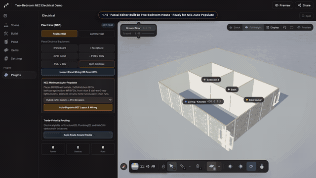
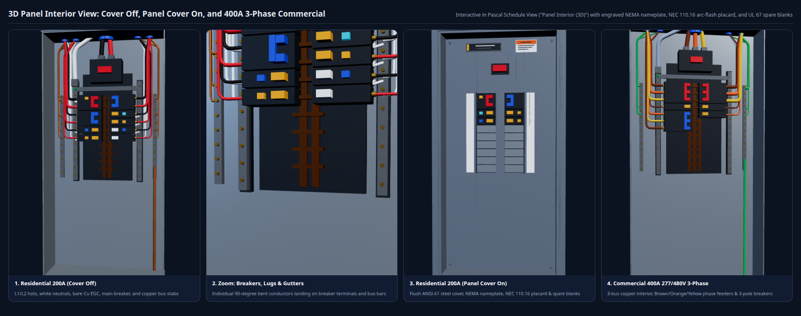
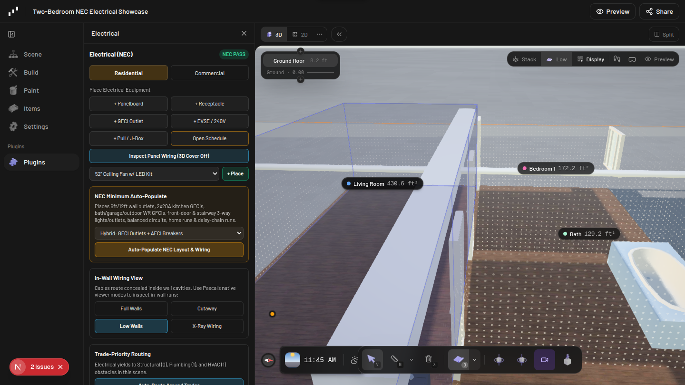

# Pascal Plugin Electrical (`@kruschdev/pascal-plugin-electrical`)

[](./LICENSE)
[](https://github.com/pascalorg/editor)
[](./docs/CAD-CATALOG.md)
[](./src/__tests__)

An open-source, MIT-licensed **Residential and Commercial NEC Electrical** plugin for [Pascal Editor](https://github.com/pascalorg/editor).

I built this as a standalone external plugin implementing Pascal's full Plugin API v1 contract (`E-014`, `E-016`, `E-017`) so it installs cleanly alongside any Pascal host without requiring upstream core merges.

## Walkthrough Video



**[Watch Full 720p HD Walkthrough Video (`assets/demo-walkthrough.mp4`)](./assets/demo-walkthrough.mp4)**

1. **NEC Minimum Auto-Populate**: One click scans Pascal walls, exterior doors, stairways, and room zones to place 6 ft / 12 ft wall outlets, 2x 20A kitchen countertop GFCI circuits, bathroom/garage/outdoor WR GFCIs, front-door and stairway 3-way switches and lights, balanced panel circuits, Home Runs (`Panel -> First Device`), and Outlet-to-Outlet Daisy-Chain runs.
2. **Trade-Priority Routing**: Conduit and cable runs automatically yield around higher-priority Structural, Plumbing (`pipe-*`), and HVAC (`duct-*`, `hvac-equipment`) trunks while tracking NEC 358.26 bend totals and real detoured lengths.
3. **Live NEC Prohibited-Location Guard**: Placing a panel in a bathroom/closet/over stairs or an outlet inside a 3 ft x 8 ft bathtub zone immediately flags **NOT TO CODE** inside both the selected-node Inspector card and the clickable Left-Rail violation list.
4. **Zoom-In Cover-Off 3D Panel Interior View**: Pop the cover off any residential (`120/240V 1P`) or commercial (`120/208V` / `277/480V 3P`) panel to inspect exposed copper busbars, main and branch breakers, neutral/ground bars, AFCI/GFCI pigtails, and every individual NEC phase-colored conductor landed on its lug.
5. **Panel Schedules and Live Price Calculator**: Auto-generated L1/L2 and 3-phase A/B/C schedules plus a priced Bill of Materials with live editable Labor Rate, Markup, Tax, and CSV export.
6. **30 Clean-Room MIT 3D CAD Models**: Panels, breakers, transformers, NEC 314.16 boxes, receptacles, switches, EVSE, 3-phase motors, 7 residential and commercial light fixtures, and conduit fittings shipped as live Three.js builders and binary `.glb` assets.

## Showcase Gallery






> **Drafting and engineering aid, not stamped engineering.** Always verify calculations, conductor sizing, and local AHJ amendments with a licensed electrical engineer or inspector before construction.

## Core Principle: Trade-Priority Routing

On a real jobsite, electrical yields to gravity-bound and rigid trades. Electrical never moves a drain pipe or sheet-metal trunk.

1. **Structural** (`beam`, `column`, `stair`, wall openings): inviolable.
2. **Plumbing** (`pipe-segment`, `pipe-fitting`, `pipe-trap`, `liquid-line`): gravity DWV and supply hold first MEP right-of-way.
3. **HVAC** (`duct-segment`, `duct-fitting`, `duct-terminal`, `hvac-equipment`, `lineset`): rigid trunks and air handlers hold second MEP right-of-way.
4. **Electrical** (`electrical:conduit-run`): automatically routes orthogonally in 3D around all higher-priority obstacles, tracks every detour, counts cumulative bend degrees against the **NEC 358.26 / 344.26 / 352.26 360-degree pull-point limit**, and feeds the actual detoured length straight into **Voltage Drop (NEC 210.19 / 215.2)** and **Material Takeoff**.

The one code exception where foreign systems cannot invade electrical is **NEC 110.26(E) Dedicated Electrical Space**: if a Pascal plumbing pipe or HVAC duct passes directly above an `electrical:panel` or `electrical:transformer` footprint, the auditor flags the violation and recommends relocating the electrical equipment clear of the piping or adding leak protection.

## Documentation

| Guide | What It Covers |
|---|---|
| **[Architecture Guide](./docs/ARCHITECTURE.md)** | System diagram, 6 entrypoint boundary gates, 4 `electrical:*` node kinds, local-yaw 2D SAT clearances, and cover-off 3D panel pipeline |
| **[NEC Engineering Reference](./docs/NEC-REFERENCE.md)** | Every implemented NEC Article and Table (`220`, `210.8`, `210.11`, `210.12`, `210.19`, `210.52`, `210.70`, `240.4(D)`, `240.24`, `310.16`, `312.2`, `314.16`, `358.26`, `404.4(C)`, `406.5(E)`, `406.9(C)`, `410.10(D)`, `410.16(C)`, `450.3(B)`, `705.12`, `110.26`, `Ch. 9`) |
| **[30-Model MIT 3D CAD Catalog](./docs/CAD-CATALOG.md)** | Full inventory of all 30 `.glb` models, dimensions in mm, NEC references, and programmatic `./cad` usage |
| **[Agent Tools Reference (`E-016`)](./docs/AGENT-TOOLS.md)** | All 8 pure Zod agent tools and pure scene operations for MCP servers, chat workflows, and headless automation |
| **[Contributing Guide](./CONTRIBUTING.md)** | Local setup, boundary gates, CAD `.glb` regeneration, and PR guidelines |

## Package Entrypoints

| Entrypoint | Export | Boundary Guarantee |
|---|---|---|
| `.` | `electricalPlugin`, `electricalHostPanel`, `electricalScheduleView`, `electricalChatExtension` | Full editor integration (`EditorHostPanel`, full-pane `EditorHostView`, `InspectorExtension`, chat cards) |
| `./render` | `electricalRenderPlugin` | Editor-free read-only viewer manifest (verified by `bun run check:render`) |
| `./cad` | `ELECTRICAL_CAD_CATALOG`, `buildElectricalCadPart`, `buildWiredPanelInteriorCad`, `buildPanelCad`, `buildElectricalBoxCad`, `buildDeviceCad`, `buildConduitRunCad` | Editor-free, React-free Three.js CAD part builders for all 30 electrical materials |
| `./nec` | Pure NEC, auto-populate, audit, trade-routing, schedule, and BOM pricing functions | Framework-free TypeScript (zero React, Three.js, or `@pascal-app/*`) |
| `./agent-tools` | `electricalAgentTools` (`PluginAgentTools`, `E-016`) | Pure Zod-only contracts (`8` tools + skill) |
| `./agent-operations` | `electricalAgentOperations` (`AgentOperations`, `E-016`) | Pure scene operations runnable on MCP, detached runtime, or live chat |

## Quick Start in a Pascal Host

```ts
import { extendPluginDiscovery } from '@pascal-app/core'
import { registerEditorHostPanel, registerEditorHostView } from '@pascal-app/editor'
import {
  electricalHostPanel,
  electricalPlugin,
  electricalScheduleView,
} from '@kruschdev/pascal-plugin-electrical'

extendPluginDiscovery(async () => [electricalPlugin])
registerEditorHostPanel(electricalHostPanel)
registerEditorHostView(electricalScheduleView)
```

For read-only viewers (zero `@pascal-app/editor` bundle overhead):

```ts
import { setPluginDiscovery } from '@pascal-app/core'
import { electricalRenderPlugin } from '@kruschdev/pascal-plugin-electrical/render'

setPluginDiscovery(async () => [electricalRenderPlugin])
```

## Development and Verification

```bash
bun install
bun run check              # tsc --noEmit + bun test src + all 4 boundary gates
bun run export:cad         # Regenerate all 30 binary .glb models in assets/cad/
bun run render:walkthrough # Re-render assets/demo-walkthrough.mp4 and .gif
```

## License

MIT. Created by Kevin Ruschman ([@kruschdev](https://github.com/kruschdev)).
