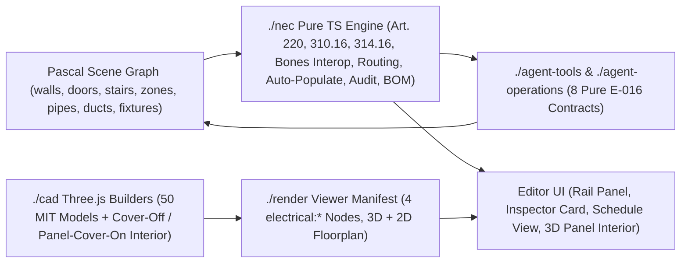

# Architecture Overview

I designed `@kruschdev/pascal-plugin-electrical` as a clean, multi-entrypoint Pascal Editor Plugin API v1 package (`E-014`, `E-016`, `E-017`) where the deterministic NEC engineering engine, the 3D CAD geometry builders, the Zod agent contracts, and the React editor UI are strictly isolated by bundler-verified boundary gates.

## High-Level System Flow

## Entrypoint Boundary Guarantees

Every subpath export in [`package.json`](../package.json) is enforced on every commit by `bun run check:render` ([`scripts/check-render-entry.ts`](../scripts/check-render-entry.ts)):

| Subpath | Module | Runtime Dependencies Allowed | Purpose |
|---|---|---|---|
| `.` | `src/index.ts` | `@pascal-app/core`, `@pascal-app/editor`, React, Three.js, Zustand | Full editor integration (`electricalPlugin`, `electricalHostPanel`, `electricalScheduleView`, `electricalChatExtension`) |
| `./render` | `src/render.ts` | `@pascal-app/core`, Three.js, Zod | Read-only viewer manifest (`electricalRenderPlugin`) with zero `@pascal-app/editor` or `next` imports |
| `./cad` | `src/cad/index.ts` | Three.js + `./nec` types | Standalone 50-model MIT electrical CAD & cover-off / Panel-Cover-On interior builders with zero React or editor imports |
| `./nec` | `src/nec/index.ts` | Pure TypeScript only | Zero React, zero Three.js, zero `@pascal-app/*`; runs identically in Node, Bun, Cloudflare Workers, or browsers |
| `./agent-tools` | `src/agent-tools.ts` | `@pascal-app/core/agent-tools`, Zod | Pure Zod schemas and skill metadata (`E-016`) for MCP servers and LLM tool registries |
| `./agent-operations` | `src/agent-operations.ts` | `@pascal-app/core`, `./nec`, `./render` | Pure deterministic scene operations returning `{ result, changes }` diffs without touching DOM or React |

## Four Editable Node Kinds (`pluginId: 'krusch:electrical'`)

1. **`electrical:panel`** (`src/nodes/panel.ts`): Residential split-phase (`120/240V-1P`) and commercial three-phase (`120/208V-3P`, `277/480V-3P`) panelboards with NEMA ratings (`NEMA-1`, `NEMA-3R`, `NEMA-4X`), bus/main ratings, solar backfeed amps, optional `coverRemoved` live interior rendering, a 3D translucent **NEC 110.26 working-space prism**, and 2D IEEE floorplan symbols.
2. **`electrical:device`** (`src/nodes/device.ts`): 25 live equipment and device kinds (`duplex`, `gfci`, `afci`, `usb-duplex`, `weatherproof-gfci`, `floor-box`, `dedicated-240v`, `evse`, `switch-1p`, `switch-3way`, `dimmer-smart`, `luminaire`, `ceiling-fan`, `under-cabinet-led`, `smoke-co`, `exit-sign`, `motor-3p`, `vfd`, `spd-type2`, `solar-inverter`, `battery-ess`, `transfer-switch`, `generator-inlet`, `pv-rapid-shutdown`, and `junction-box`) supporting full `WIRE_GAUGE_ORDER` (`#14` to `750kcmil`), live **NEC 314.16 Box Fill** tracking, and integral-enclosure gang-box exemption (`usesSeparateRoughInBox`).
3. **`electrical:conduit-run`** (`src/nodes/conduit-run.ts`): 3D polyline raceways and cables (`nm-b`, `mc`, `emt`, `pvc-40`, `rmc`) with swept cylindrical segments, shared elbow fittings, 10-color per-circuit coding (`CIRCUIT_COLOR_PALETTE` synced across 3D runs, 2D floorplans, and the Electrical rail Circuit Legend, with `circuitNumber` included in `geometryKey`), live ampacity derating, Chapter 9 fill, 360-degree bend limits, and voltage drop.
4. **`electrical:transformer`** (`src/nodes/transformer.ts`): Commercial dry-type step-down transformers (`480V -> 208Y/120V 3P`) with NEC Table 450.3(B) FLA/OCPD sizing, rotated 3D primary/secondary ports, and local-yaw working-space clearance envelopes.

## Trade-Priority Obstacle Routing (`src/nec/routing.ts`)

Electrical runs never relocate structural or gravity-bound trades. `extractTradeObstacles` reads every Pascal `beam`, `column`, `stair`, `pipe-segment`, `pipe-fitting`, `pipe-trap`, `liquid-line`, `duct-segment`, `duct-fitting`, `duct-terminal`, `hvac-equipment`, and `lineset` node into 3D bounding volumes with configurable clearance margins.

`routeElectricalRun` evaluates three code-compliant 3D routing families using `extractRoutingCavities` (inspecting Pascal `roof`, `ceiling`, raised `slab`, and lower `crawlspace`/`basement` levels):
1. **Wall-Cavity Manhattan**: Orthogonal stud chases and Dijkstra wall-top-plate runs around wall corners (always used on slab-on-grade flat-roof builds and for all rigid `EMT`/`RMC`/`PVC-40` conduit per `NEC 110.12 / 358.30`).
2. **Hybrid Wall-to-Attic Euclidean (`NEC 334.23 / 320.23`)**: Vertical stud-bay riser through bored top plates into a straight Euclidean attic crossing whenever shorter and clash-free for `NM-B`/`MC`.
3. **Hybrid Wall-to-Crawl-Space Euclidean (`NEC 334.15(C) / 334.12(B)(4)`)**: Vertical stud-bay drop through sole plates into dry floor-joist cavities for low wall outlets (automatically blocked for `NM-B` in wet/damp crawl spaces).

Every candidate detects segment intersections against higher-priority obstacles (including diagonal over/under detours in attics and crawl spaces), deduplicates coincident vertices, counts cumulative bend angles (`countPathBendDegrees`) against the **NEC 358.26 360-degree pull-point limit**, and feeds the exact routed 3D length straight into **Voltage Drop** (`calculateVoltageDrop`) and **Material Takeoff** (`buildElectricalTakeoff`).

## Decoupled Framing Interop (`src/nec/framing-interop.ts`)

I integrated with `@pascal-app/plugin-bones` strictly through Pascal's scene graph with zero hard npm dependency. When `bones:framing` or `bones:service` nodes are present on the active level, `resolveWallFramingContext` reads `studSpacingIn` (`16" OC` or `24" OC`) and per-wall `wallOverrides` (bypassing CMU masonry walls cleanly), computes stud centerlines using `computeWallStudPositions`, snaps nail-on outlets, GFCIs, and switches flush against the side face of the nearest stud (`snapWallOffsetToStud`, clamped to remaining NEC 210.52(A)/(C) spacing slack), and centers `MDP-1` cleanly inside a stud bay (`snapPanelOffsetToStudBay`) or aligns with `bones:service` (`serviceType: 'panel'`). When Bones is not installed, the engine defaults gracefully to standard `16" OC` stud centers.

## Local-Yaw 2D SAT Clearance Checking and Multi-Level Isolation (`src/nec/audit.ts`)

Rotated panels and floor-mounted transformers cannot be checked accurately with world-axis AABBs. `getEquipmentSpacePrisms` builds oriented prisms aligned to each panel or transformer's `rotation` yaw (`cos`, `sin`), and `prismIntersectsAabb` runs a full 2D Separating Axis Theorem (SAT) test in XZ plus Y overlap against every cabinet, fixture, column, HVAC unit, and overhead pipe/duct. Shared level ancestry helpers (`resolveNodeLevelId` and `belongsToLevel` in `src/nec/routing.ts`) strictly scope rooms, wet fixtures, stairways, dedicated circuits, and trade obstacles to each node's owning level so multi-story buildings never produce cross-floor false positives. CSV panel schedules and BOM exports also pass every cell through `sanitizeCsvCell` to neutralize spreadsheet formula injection triggers.

## Cover-Off 3D Panel Interior Pipeline (`src/cad/panel-interior.ts` and `src/ui/panel-interior-view.tsx`)

`buildWiredPanelInteriorCad` consumes a live `PanelSchedule` and generates:
- A hollow galvanized steel tub with rear mounting flanges and knockouts.
- Exposed copper 2-bus (split-phase) or 3-bus (three-phase) central stabs, main breaker or MLO lugs, and service entrance feeders.
- Isolated neutral and ground bus bars with an NEC 250.28 green bonding screw on main-breaker service panels.
- Populated 1P, 2P, and 3P molded-case breakers with colored handles, AFCI/GFCI test buttons, neutral pigtails, and brass wire lugs.
- Every individual Hot, Neutral, and Ground branch conductor routed down the side wiring gutters with 90-degree bends into its exact terminal, using NEC phase color coding (`Black/Red` for 120/240V, `Black/Red/Blue` for 120/208V, `Brown/Orange/Yellow` for 277/480V).

`PanelInteriorView` mounts a single persistent `WebGLRenderer` with `ResizeObserver`, preserves camera orbit across toggle changes, supports **Cover Off / Panel Cover On / Cover Closed** and **Hots / Neutrals / Grounds / Feeders** visibility filters, and raycasts clicks on any wire or breaker to highlight its circuit details.

## UI Store Isolation (`src/ui/store.ts`)

All plugin-local UI state (`occupancy`, `activeTab`, `selectedPanelId`, `residentialMethod`, `commercialBuildingType`) lives inside `useElectricalUi`. Scene edits triggered from the rail panel (such as `Auto-Populate NEC Layout & Wiring` or `Auto-Route Around Trades`) wrap multi-node creations inside Pascal's `runAsSingleSceneHistoryStep(useScene, ...)` so one `Ctrl+Z` cleanly undoes the entire layout.
