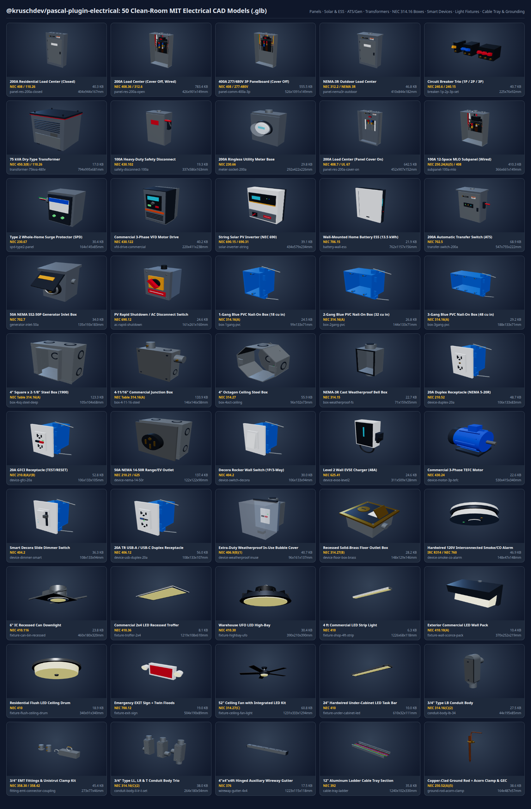

# 30-Model Clean-Room MIT Electrical 3D CAD Library

Every electrical material in [`@kruschdev/pascal-plugin-electrical/cad`](../src/cad/index.ts) is built procedurally from clean-room Three.js geometry (MIT license, zero third-party meshes) and pre-exported to binary `.glb` + studio `.png` thumbnails in [`assets/cad/`](../assets/cad/catalog.json) following Pascal's `public/items/<slug>/` layout.



## Programmatic Usage (`./cad`)

```ts
import {
  ELECTRICAL_CAD_CATALOG,
  buildElectricalCadPart,
  buildWiredPanelInteriorCad,
  buildConduitRunCad,
} from '@kruschdev/pascal-plugin-electrical/cad'
import { buildPanelSchedule } from '@kruschdev/pascal-plugin-electrical/nec'

// Build any of the 30 catalog models as a Three.js Group
const gfciMesh = buildElectricalCadPart('device-gfci-20a')

// Build a live cover-off panel interior wired to match a scene's PanelSchedule
const openPanel = buildWiredPanelInteriorCad({
  schedule: buildPanelSchedule(panelNode, deviceNodes, conduitRuns),
  nemaRating: 'NEMA-1',
  viewMode: 'cover-off', // 'cover-off' | 'panel-cover-on' | 'closed'
})
```

To regenerate all 30 `.glb` assets and thumbnails after editing CAD geometry:

```bash
bun run export:cad
bun scripts/render-cad-thumbnails.ts
```

## Complete 30-Model Catalog

### Panels, Breakers and Distribution Gear (8)
| Slug | Name | Dimensions (mm) | NEC Ref |
|---|---|---|---|
| `panel-res-200a-closed` | 200A Residential Load Center (Closed) | `404 x 944 x 167` | NEC 408 / 110.26 |
| `panel-res-200a-open` | 200A Load Center (Cover Off, Wired) | `426 x 901 x 149` | NEC 408.36 / 312.6 |
| `panel-comm-400a-3p` | 400A 277/480V 3P Panelboard (Cover Off) | `526 x 1091 x 149` | NEC 408 / 277-480V |
| `panel-nema3r-outdoor` | NEMA-3R Outdoor Load Center | `410 x 844 x 182` | NEC 312.2 / NEMA 3R |
| `breaker-1p-2p-3p-set` | Circuit Breaker Trio (1P / 2P / 3P) | `225 x 76 x 92` | NEC 240.6 / 240.15 |
| `transformer-75kva-480v` | 75 kVA Dry-Type Transformer | `794 x 995 x 681` | NEC 450.3(B) / 110.26 |
| `safety-disconnect-100a` | 100A Heavy-Duty Safety Disconnect | `337 x 586 x 163` | NEC 430.102 |
| `meter-socket-200a` | 200A Ringless Utility Meter Base | `292 x 422 x 226` | NEC 230.66 |

### NEC 314.16 Outlet and Junction Boxes (7)
| Slug | Name | Dimensions (mm) | NEC Ref |
|---|---|---|---|
| `box-1gang-pvc` | 1-Gang Blue PVC Nail-On Box (18 cu in) | `99 x 133 x 71` | NEC 314.16(A) |
| `box-2gang-pvc` | 2-Gang Blue PVC Nail-On Box (32 cu in) | `144 x 133 x 71` | NEC 314.16(A) |
| `box-3gang-pvc` | 3-Gang Blue PVC Nail-On Box (44 cu in) | `188 x 133 x 71` | NEC 314.16(A) |
| `box-4sq-steel-deep` | 4" Square x 2-1/8" Steel Box (1900, 30.3 cu in) | `105 x 104 x 68` | NEC Table 314.16(A) |
| `box-4-11-16-steel` | 4-11/16" Commercial Junction Box (42 cu in) | `146 x 146 x 58` | NEC Table 314.16(A) |
| `box-4oct-ceiling` | 4" Octagon Ceiling Steel Box (21.5 cu in) | `96 x 102 x 73` | NEC 314.27 |
| `box-weatherproof-fs` | NEMA-3R Cast Weatherproof Bell Box | `71 x 159 x 55` | NEC 314.15 |

### Wiring Devices, EVSE and Motors (6)
| Slug | Name | Dimensions (mm) | NEC Ref |
|---|---|---|---|
| `device-duplex-20a` | 20A Duplex Receptacle (NEMA 5-20R) | `106 x 133 x 83` | NEC 210.52 |
| `device-gfci-20a` | 20A GFCI Receptacle (TEST/RESET) | `106 x 133 x 105` | NEC 210.8(A)/(B) |
| `device-nema-14-50r` | 50A NEMA 14-50R Range/EV Outlet | `122 x 122 x 90` | NEC 210.21 / 625 |
| `device-switch-decora` | Decora Rocker Wall Switch (1P/3-Way) | `106 x 133 x 94` | NEC 404.2 |
| `device-evse-level2` | Level 2 Wall EVSE Charger (48A) | `311 x 509 x 128` | NEC 625.41 |
| `device-motor-3p-tefc` | Commercial 3-Phase TEFC Motor | `530 x 415 x 340` | NEC 430.24 |

### Residential and Commercial Light Fixtures (7)
| Slug | Name | Dimensions (mm) | NEC Ref |
|---|---|---|---|
| `fixture-can-6in-recessed` | 6" IC Recessed Can Downlight | `460 x 180 x 320` | NEC 410.116 |
| `fixture-troffer-2x4` | Commercial 2x4 LED Recessed Troffer | `1219 x 108 x 610` | NEC 410.36 |
| `fixture-highbay-ufo` | Warehouse UFO LED High-Bay | `390 x 210 x 390` | NEC 410.30 |
| `fixture-shop-4ft-strip` | 4 ft Commercial LED Strip Light | `1226 x 68 x 118` | NEC 410 |
| `fixture-wall-sconce-pack` | Exterior Commercial LED Wall Pack | `370 x 252 x 219` | NEC 410.10(A) |
| `fixture-flush-ceiling-drum` | Residential Flush LED Ceiling Drum | `340 x 91 x 340` | NEC 410 |
| `fixture-exit-sign` | Emergency EXIT Sign + Twin Floods | `504 x 190 x 89` | NEC 700.12 |

### Conduit Bodies and Fittings (2)
| Slug | Name | Dimensions (mm) | NEC Ref |
|---|---|---|---|
| `conduit-body-lb-34` | 3/4" Type LB Conduit Body | `44 x 195 x 85` | NEC 314.16(C)(2) |
| `fitting-emt-connector-coupling` | 3/4" EMT Fittings and Unistrut Clamp Kit | `273 x 77 x 46` | NEC 358.30 / 358.42 |
